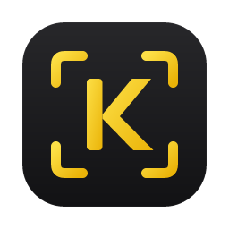

<div align="center">
  
  <h1>K8sFocus</h1>
  <p>A fast, open-source desktop Kubernetes client — built to match Lens feature-for-feature.</p>

  <p>
    <a href="https://github.com/imashiksarkar/K8sFocus/releases/latest">
      
    </a>
    <a href="https://github.com/imashiksarkar/K8sFocus/releases/latest">
      
    </a>
    
    
  </p>
</div>

---

## Download

Go to the [**latest release**](https://github.com/imashiksarkar/K8sFocus/releases/latest) and pick the installer for your platform:

| Platform | File |
|---|---|
| macOS — Apple Silicon | `K8sFocus_<version>_aarch64.dmg` |
| macOS — Intel | `K8sFocus_<version>_x64.dmg` |
| Windows | `K8sFocus_<version>_x64-setup.exe` |
| Ubuntu / Debian | `K8sFocus_<version>_amd64.deb` |
| Other Linux | `K8sFocus_<version>_amd64.AppImage` |

### First launch on macOS

K8sFocus is not notarized by Apple, so macOS will warn you the first time.

1. Open the `.dmg` and drag **K8sFocus** to **Applications**.
2. Try to open it. When macOS blocks it, go to **System Settings → Privacy & Security** and click **Open Anyway**.

If macOS says the app "is damaged", run this once in Terminal:
```sh
xattr -dr com.apple.quarantine /Applications/K8sFocus.app
```

### Windows SmartScreen

Click **More info → Run anyway**.

---

## Features

| Area | Highlights |
|---|---|
| **Cluster management** | Read `~/.kube/config` and `KUBECONFIG`, list contexts, hotbar of pinned clusters, multiple clusters open at once |
| **Workloads** | Pods, Deployments, DaemonSets, StatefulSets, ReplicaSets, Jobs, CronJobs — with scale, restart, rollback and delete |
| **Pod tools** | Live log streaming, exec shell, port-forward, container picker |
| **Config & Secrets** | ConfigMaps, Secrets (reveal/edit), ResourceQuotas, HPA, webhooks |
| **Network** | Services, Ingresses, NetworkPolicies, port-forward manager |
| **Storage** | PVCs, PVs, StorageClasses |
| **Helm** | Browse charts, install, upgrade, rollback, uninstall |
| **Access control** | ServiceAccounts, Roles, ClusterRoles and their bindings |
| **Custom resources** | Generic tables for any CRD using `additionalPrinterColumns` |
| **UX** | Live watch tables, YAML editor (Monaco), command palette (⌘K), dark theme |
| **Auto-update** | Checks for new versions on startup, one-click update |

See [ROADMAP.md](ROADMAP.md) for the full task list and progress.

---

## Tech stack

| Layer | Technology |
|---|---|
| Desktop shell | [Tauri 2](https://tauri.app) (Rust) |
| Kubernetes | [`kube-rs`](https://kube.rs) |
| Frontend | React 19 + TypeScript + Vite |
| UI | Tailwind CSS v4 + [shadcn/ui](https://ui.shadcn.com) |
| Package manager | [Bun](https://bun.sh) |

---

## Development

### Prerequisites

- [Rust](https://rustup.rs) (stable)
- [Bun](https://bun.sh)
- Xcode Command Line Tools (macOS): `xcode-select --install`
- Linux system deps (Ubuntu/Debian):
  ```sh
  sudo apt-get install -y libwebkit2gtk-4.1-dev libappindicator3-dev librsvg2-dev patchelf build-essential libssl-dev
  ```

### Run locally

```sh
bun install
bun run tauri dev      # hot-reload dev mode
```

### Build

```sh
bun run tauri build    # .app + .dmg (or .deb/.AppImage/.exe depending on OS)
# Output: src-tauri/target/release/bundle/
```

### Lint & format

```sh
cd src-tauri
cargo fmt
cargo clippy --all-targets -- -D warnings
```

---

## Releasing

### One-time setup

1. Generate the updater signing key:
   ```sh
   bun run tauri signer generate -w ~/.tauri/k8sfocus.key
   ```
2. Copy the **public** key from `~/.tauri/k8sfocus.key.pub` into `src-tauri/tauri.conf.json` → `plugins.updater.pubkey` and commit.
3. Add these two secrets to the repo (**Settings → Secrets → Actions**):
   - `TAURI_SIGNING_PRIVATE_KEY` — contents of `~/.tauri/k8sfocus.key`
   - `TAURI_SIGNING_PRIVATE_KEY_PASSWORD` — the password (can be empty)

### Publishing a new release

1. Bump `version` in `src-tauri/tauri.conf.json` (and optionally `Cargo.toml` / `package.json`) and push to `main`.
2. On GitHub → **Releases → Draft a new release**.
3. Set the tag to `v<version>` — e.g. `v0.2.0` (must match `tauri.conf.json`).
4. Write release notes and click **Publish release**.
5. The **Release** workflow fires automatically, builds all platforms, and uploads installers to the release within ~20 minutes.

---

## Contributing

Pull requests are welcome. For large changes please open an issue first to discuss what you'd like to change.

1. Fork the repo and create a branch.
2. Make your changes.
3. Run `cargo fmt && cargo clippy` and `bun run build` to make sure everything passes.
4. Open a PR against `main`.

---

## License

[MIT](LICENSE)
